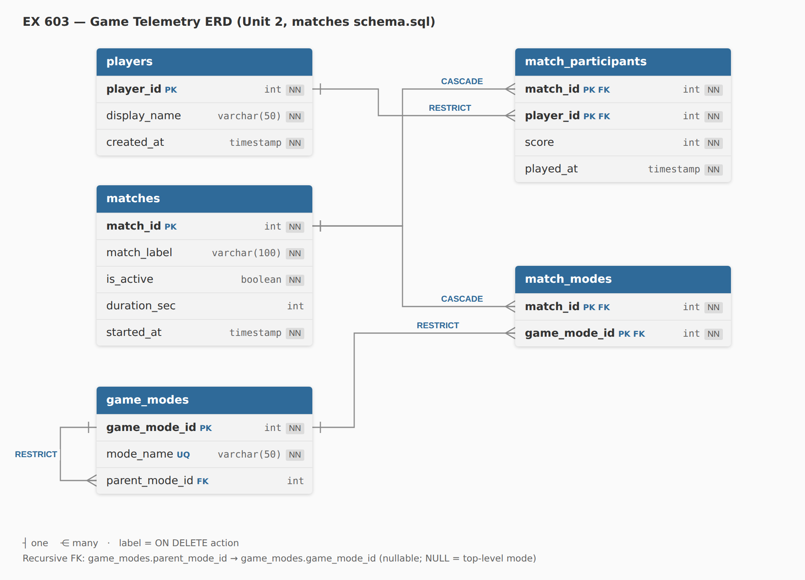

# EX 603 — Game Telemetry Database

A relational database modelling the telemetry backend of a competitive
multiplayer game: players compete in matches, each match is played under one or
more game modes, and every player's result in a match is recorded as a scored
event.

**Theme:** Game Telemetry (Theme 3)

## Domain

This project models the data layer behind a competitive online game — the store
that sits under the ranked ladder, the match-history screen, and the end-of-season
stats. Every time a match finishes, the game server records who played, in which
match, under which mode, and how each player performed. Over many matches those
records become the raw material for leaderboards, matchmaking, and balance
decisions.

The design uses five entities. Players are the actors on the platform. Matches are
the game sessions they take part in, each flagged as live or completed and carrying
a duration. Game modes classify matches (Ranked Solo, Team Deathmatch, and so on),
linked to matches through a match–modes junction that allows a match to carry more
than one mode. Match participants is the high-volume fact table: one row per player
per match, holding the score and the time the result was recorded.

The platform must answer questions such as: which players have the highest average
score, and over how many matches? Which game modes are played most often? How many
matches are still active versus completed? What is the score distribution within a
mode? Those questions drive the queries built in later units; the score column on
match participants is the metric they aggregate.

## Entity Relationship Diagram



## Schema

The whole database is created by [`schema/schema.sql`](schema/schema.sql)
(PostgreSQL 14+). It opens with a reset block, so it can be re-run on the same
database without any manual cleanup:

```
createdb game_telemetry
psql -d game_telemetry -v ON_ERROR_STOP=1 -f schema/schema.sql
```

### Tables

| Table | Role | Key |
|-------|------|-----|
| `players` | Actor: a person who plays matches. | `player_id` (identity) |
| `game_modes` | Catalog of modes. A mode can sit under a parent mode family through `parent_mode_id`. | `game_mode_id` (identity) |
| `matches` | Producer: one game session, either live or completed. | `match_id` (identity) |
| `match_modes` | Junction resolving matches ↔ game_modes (M:N). | (`match_id`, `game_mode_id`) |
| `match_participants` | Event / fact table: one scored result per player per match. `score` is the metric for later units. | (`match_id`, `player_id`) |

Tables are created in the order players → game_modes → matches →
match_modes → match_participants and dropped in the reverse order.

### Design decisions worth noticing

- **The primary key enforces the grain.** `match_participants` is keyed on
  (`match_id`, `player_id`), so a player can have only one result per match.
  A retried write fails on the key instead of double-counting a score.
- **A match owns its facts.** Deleting (voiding) a match cascades to its
  results and mode tags. Players and game modes are reference data, and every
  foreign key pointing at them is `RESTRICT`, so no delete can quietly rewrite
  historical leaderboards. Account removal anonymises the player row instead.
- **The recursive foreign key is on `game_modes`.** `parent_mode_id` groups modes
  into families ('Ranked Solo' under 'Ranked') so mode usage can be rolled up.
  It is `RESTRICT`, and a CHECK stops a mode from being its own parent.
- **Match state is enforced in the schema.** A CHECK ties `is_active` to
  `duration_sec`: a live match has no duration and a completed match must have
  one.
- **Every constraint is named** (`pk_`, `fk_`, `uq_`, `chk_`), so an error
  message names the rule that was broken.
- **No derived values are stored.** End times and aggregates are computed at
  query time.

The constraints table, the reasoning behind each `ON DELETE` choice, the CHECK
constraints, and what changed from Unit 1 are in
[analysis/unit2.md](analysis/unit2.md). The Unit 1 schema definition,
constraints and modelling justification are in
[schema/schema-definition.md](schema/schema-definition.md),
[schema/constraints.md](schema/constraints.md) and
[analysis/unit1.md](analysis/unit1.md).